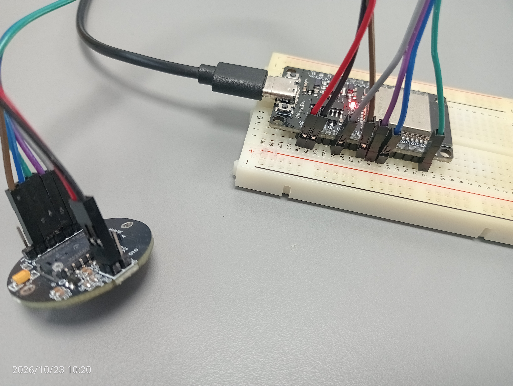

# PMW3389 Optical Motion Tracker

A high-precision, real-time Pygame tracking dashboard and kinematic analyzer for **PMW3389 optical sensors** communicating via an **ESP32** microcontroller over serial[cite: 1, 2, 4].

---

## 📸 Hardware Setup & Wiring

The hardware setup interfaces an ESP32 development board with a PMW3389 optical flow sensor via SPI[cite: 3, 4].


*Figure 1: ESP32 micro-controller wired to the PMW3389 optical sensor module on a breadboard.*

### Pin Mapping Reference
| PMW3389 Pin | ESP32 GPIO / Rail | Description |
| :--- | :--- | :--- |
| **CS** | GPIO 5 | Chip Select |
| **MOSI** | GPIO 23 (VSPI MOSI) | Master Out Slave In |
| **MISO** | GPIO 19 (VSPI MISO) | Master In Slave Out |
| **SCLK** | GPIO 18 (VSPI SCLK) | Serial Clock |
| **VDD / VCC** | 3.3V | Power Supply |
| **GND** | GND | Ground |

---

## 🚀 Features

* **Real-Time Trajectory Canvas:** Visualizes smooth movement paths and tracks absolute coordinates $(X, Y)$ on a 900x800 rendering window.
* **Sensor Quality Telemetry (SQUAL):** Live surface tracking quality metric with color-coded status badges, real-time sparkline history, and diagnostic feedback.
* **Polar Heading & Compass Domain Conversion:** Automatically transforms Cartesian $(dx, dy)$ grid deltas into polar coordinates—computing precise heading angles ($\theta$) and cardinal directions (e.g., North, East, South-West) rendered live via a companion compass widget.
* **Performance Metrics & Dynamics:** Tracks instantaneous speed (IPS), peak speed, accumulated distance in centimeters, and custom DPI configurations.
* **Session Recording & Export:** Built-in recording tool to log full frame events and export comprehensive session performance reports to text files.
* **Quick Actions:** Instant screenshot capture (`[P]`), trail clearing (`[C]`), and recording toggle (`[R]`)[cite: 1, 2].

---

## 🛠️ Requirements & Dependencies

Make sure you have Python installed along with the required libraries:

```bash
pip install pygame pyserial matplotlib
